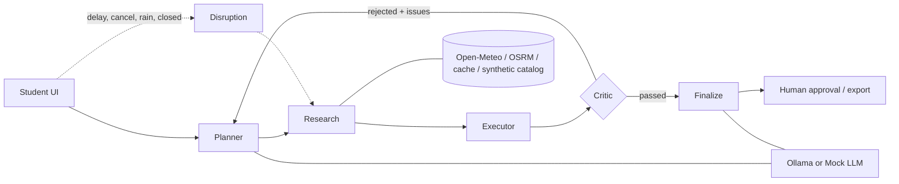

# TripGuard - a disruption-aware, self-validating student trip planner (Agentic AI PoC)

CA-3 proof of concept for *Foundation of Agentic AI*. Domain: **student-budget group travel in India**
(Goa, Jaipur, Manali, Rishikesh, Udaipur; origins Pune, Mumbai, Delhi, Bengaluru, Hyderabad, Ahmedabad).

**Idea.** Most "AI trip planners" write a nice itinerary and never check it. TripGuard plans, then an
independent **Critic** agent re-computes every price from the catalog and checks opening hours, travel time,
weather, overlaps, stay coverage and budget. If a check fails, the **Planner** reads the machine-readable issues,
relaxes the strategy (comfort -> value -> cheapest -> free activities) and the loop runs again. When reality
changes (delay, cancellation, rain, closure) a **Disruption** agent locks what is booked and repairs *only* the
affected days, then shows a diff.

```
Planner -> Research -> Executor -> Critic --passed--> Finalize -> human approval -> export
   ^                                  |
   +-------- rejected (retries) ------+      Disruption -> Research -> Executor -> Critic -> Finalize
```
Diagram: `docs/architecture.png` (source `docs/architecture.dot`, regenerate with `python scripts/make_diagram.py`).



## Quick start
```bash
python -m venv .venv && source .venv/bin/activate     # Windows: .venv\Scripts\activate
pip install -r requirements.txt
streamlit run app.py
```
The app uses **Ollama with `qwen3:4b`** by default (Advanced > Ollama model to change it). No paid APIs, no keys:
```bash
ollama pull qwen3:4b
ollama serve                 # if not already running (needs Ollama 0.9+ so qwen3 can skip its thinking step)
```
The sidebar shows whether the model is ready. If Ollama is not running, built-in destinations still plan with the rule-based parser;
new destinations and free-form wording need the model.

The UI has one input (a chat box). Anything you don't say (origin, days, travellers, budget, start date) is assumed and listed under the plan.
Disruption repair (delay, cancellation, rain, closure) is still in the engine and CLI (`run_cli.py --disrupt ...`) but not in the UI.

CLI (no Streamlit needed):
```bash
python run_cli.py --text "4 day Goa trip from Pune for 3 friends budget 18000" --start-date 2026-10-23
python run_cli.py --disrupt return_cancelled          # also: outbound_delay:180, rain_day:2, attraction_closed:goa-aguada
python run_cli.py --llm ollama --model qwen3:4b --simulate-down
```

## Any destination with Ollama
The bundled catalog has 5 destinations, but with **Ollama (local)** selected you can type *any place in India*
("3 day Hampi trip from Bengaluru for 2 friends, budget 9000, heritage") and an unknown name triggers this:

1. The request parser (rules + Ollama) spots a place outside the catalog.
2. `tripguard/generator.py` locates it - Open-Meteo geocoder if **Live data** is on, otherwise the model's coordinates (bounds-checked to India).
3. Ollama is asked three small JSON questions: basic facts + climate, 8-10 attractions, stays + food.
4. Every field is parsed and clamped; bad coordinates, hours, prices and tags are repaired; missing stay tiers / food kinds
   are filled from templates so the planner's budget-relaxation ladder still works.
5. The profile is saved under `cache/generated/` and is **re-used offline next time** (no Ollama needed to re-plan it).
6. Transport for any origin/destination pair is generated from distance formulas (same as the bundled timetable).

Safety/honesty: generated places are labelled *(AI-estimated)*, the plan always carries a "destination data is AI-estimated"
warning, and the UI/export say the Critic validated the plan against the *profile*, not against reality. Non-Indian places are
rejected. Small models (3B) may fail to produce usable JSON - you then get a clear message; `llama3.1:8b` or `qwen2.5:7b` work better
for generation (`ollama pull qwen2.5:7b`, then pick it in the sidebar). Not verified here: real Ollama output (tests use mocked replies).

## Tests
```bash
python -m unittest discover -s tests -v        # or: pip install -r requirements-dev.txt && pytest
```
63 tests: parser, data-source fallbacks, Critic fault-injection (tampered price, overlap, opening hours,
invented amounts), retry loop, infeasible requests, four disruptions, Ollama adapter and any-destination generation (HTTP mocked), UI smoke test.

## Where the "agentic" parts are
| Requirement | Where |
|---|---|
| Planner / Research / Executor / Critic | `tripguard/agents/*.py` |
| Orchestration, loops, conditional routing | `tripguard/graph.py` (LangGraph if installed, equivalent built-in runner otherwise) |
| Tools & multiple sources w/ fallbacks | `tripguard/tools/` - weather: live -> cache -> climatology; routing: OSRM -> cache -> haversine; synthetic catalog/timetable |
| LLM use | `tripguard/llm.py` - Ollama only parses gaps in the request and words the summary; every number comes from code |
| Output validation | `agents/critic.py` (13 checks, incl. LLM-summary grounding: invented ₹ amounts are rejected) |
| Human in the loop | Export tab requires explicit approval; e-mail is a mock preview |
| Observability | live agent trace in the UI, attempt history, data-source table |

## Honest limitations
- All prices, timetables, stays and venues are **synthetic sample data**; nothing is bookable.
- Live mode (Open-Meteo weather, OSRM travel times) falls back to cache/bundled data when offline; the app labels which source was used.
- 5 destinations, India only, 2-7 days, 1-8 travellers. The rule-based parser handles common phrasings, not arbitrary language.
- Small local LLMs can ignore instructions; that is why they are only allowed to fill gaps/wording and are checked by the Critic.
- The planner is a greedy scheduler, not an optimal solver.

## Future scope
Real booking APIs behind the same tool interface, user preference memory across trips, multi-city routes,
an MCP server exposing the tools, evaluation against human-made itineraries.

*Verification note:* the pure-Python core, CLI and all tests were run in a sandbox without Streamlit or LangGraph;
the UI was exercised against a strict Streamlit stub. Run `streamlit run app.py` once on your machine before the demo.
